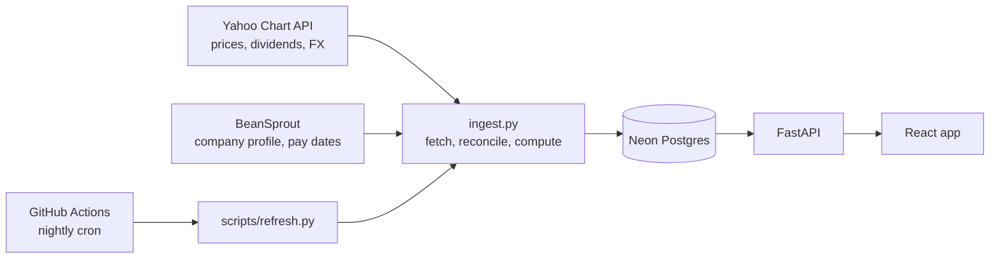

# Singapore Dividends

A free portfolio tracker for Singapore dividend investors. It covers 108 SGX-listed dividend stocks, REITs and business trusts with 10 years of daily prices and full dividend history, refreshed every night.

**Live:** https://singapore-dividends.vercel.app. Stock pages and Browse are public; portfolio features need a Google sign-in.

## What it does

- **Research any stock.** Price history, full dividend history (back to 2000 for older listings), forward / trailing / 5-year-average yield, payout ratio and an annual dividends-per-share chart.
- **Track a portfolio by lot.** Each purchase is its own lot with its own cost basis, so yield on cost and unrealised gain are exact per lot and roll up per stock.
- **See the whole portfolio.** Value over time, monthly dividend income for the last 12 months, projected income for the next 12, and sector and currency breakdowns.

## How it works



### Sources

| Source | Provides | Notes |
|---|---|---|
| Yahoo Chart API | Daily closes, dividend amounts and ex-dates, latest price, spot FX | Source of truth for every number |
| BeanSprout | Name, sector, industry, description, market cap, P/E, payment frequency, dividend pay dates | Data is embedded as inline JavaScript, extracted with regex. Its own yield and price figures are ignored because they pick up values from an embedded peer table. |

Every stock goes through one ingestion path, `ingest_stock()` in `server/app/services/ingest.py`, whether it comes from the seed scripts, the nightly refresh or a user adding a new ticker.

### Metrics are computed, not scraped

Yields come from the stored dividend history rather than any source's own figure:

- **TTM yield**: dividends with an ex-date in the trailing 365 days, divided by the latest close.
- **Forward yield**: the sum of the most recent N payments, where N is the larger of the stated payments per year and the count actually paid last year. This picks up a cut or a raise as soon as it's paid, unlike TTM.
- **5-year average yield**: the mean of the last five complete calendar years, each year's dividends divided by that year's final close. It stays null unless at least 3 of the 5 years have data.
- **Payout ratio**: TTM dividends divided by EPS, approximated as price over P/E. It's null for REITs, whose accounting earnings include property revaluations, so the ratio means nothing for them.

### Data-quality rules

- **No fabricated values.** Missing data stays null instead of being estimated or hard-coded. REIT addresses, pay dates before about 2013, and yields for recently listed stocks are all left blank.
- **Full precision storage.** Amounts and yields are stored unrounded and summed with `math.fsum`. Rounding happens only for display, because some REITs pay under S$0.01 per unit.
- **Idempotent loads.** Prices are unique on `(stock_id, date)` and dividends on `(stock_id, ex_date)`, and both are upserted. Prices load incrementally, fetching only the gap since the last stored date, so a missed night catches up on the next run.
- **Reconciliation.** A full dividend refresh deletes stored rows the source no longer reports, so corrections upstream don't leave stale duplicates.
- **Corporate actions.** Yahoo's dividend history is adjusted for splits and bonus issues. For example, DBS's 1-for-10 bonus issue in April 2024 scales earlier amounts by 10/11. This was checked against an SGX-style dividend table; current yields only use post-adjustment payments.
- **Currencies.** Stock pages show each stock's own currency (SGD, USD, GBP or EUR). Anything aggregated converts to SGD at the latest spot rate.

### Orchestration

- **Daily schedule.** A GitHub Actions workflow runs Monday to Saturday as a prices-only refresh, which takes about 5 minutes, and on Sunday as a full refresh of profiles, dividends and prices, which takes about 9 minutes.
- **Failure handling.** A run fails only if more than 25% of stocks fail, so one flaky source call doesn't sink the whole night.
- **Watchdog.** GitHub's scheduler is best-effort and sometimes skips a run entirely. A second workflow checks later each day and dispatches a fallback run if no refresh succeeded.
- **No overlap.** A concurrency group stops a late scheduled run and a fallback from running at the same time.

### Data model

| Table | Grain |
|---|---|
| `stocks` | One row per ticker: profile plus the latest computed metrics |
| `daily_prices` | One row per stock per trading day (about 254k rows) |
| `dividends` | One row per stock per ex-date, back to 2000 (about 4,100 rows) |
| `fx_rates` | One row per foreign currency: latest SGD spot rate |
| `users`, `portfolios` | One portfolio per Google account |
| `holdings` | One row per purchase lot |

### Known limitations

- **Special dividends** aren't separated from regular ones. Both sources report only a combined amount per ex-date, so a special payment can inflate forward yield for up to a year.
- **Historical portfolio value** applies today's FX rate to every past date for foreign-currency holdings.
- **Data gaps.** The nightly run is typically several hours late because of GitHub's scheduler, and Yahoo occasionally publishes a day's SGX closes late. Both catch up automatically.

## Stack

React 19, TypeScript, Vite, Tailwind CSS, Recharts, TanStack Query and Zustand on the frontend. FastAPI, async SQLAlchemy and Alembic on the backend, with Neon Postgres. Hosted on Vercel and Render, with the nightly refresh on GitHub Actions.

## Running locally

Requires Python 3.12 and Node 20+.

```bash
# backend (from server/)
python -m venv .venv && .venv/Scripts/pip install -r requirements.txt
.venv/Scripts/python -m uvicorn app.main:app --reload --port 8000

# frontend (from client/)
npm install && npx vite --port 5173
```

The backend reads `DATABASE_URL`, `GOOGLE_CLIENT_ID`, `JWT_SECRET` and `CORS_ORIGINS` from `server/.env`. The frontend reads `VITE_GOOGLE_CLIENT_ID` from `client/.env`; Vite proxies `/api` to the backend.

## Built with Claude Code

This project was built with [Claude Code](https://claude.com/claude-code), Anthropic's AI coding agent. I set the product direction and the data rules, such as no fabricated values, computed rather than scraped yields, and lot-level tracking. I also made the design calls and checked the data against reference sources. Claude Code wrote most of the implementation.
